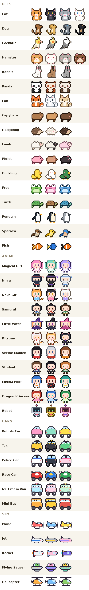
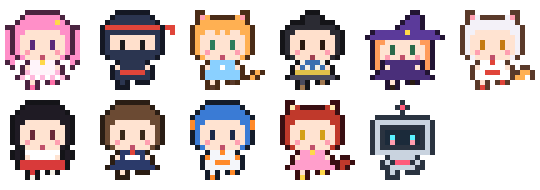
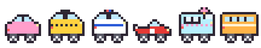
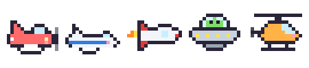

# Pixel Pets 🐾

Tiny, cute pixel-art pets, chibi anime characters, cars and flying things that follow your cursor around the page. **Click a pet** to pick its type, color, size and speed, switch the language (English / العربية), give it a treat, or add more pets. Inspired by [oneko.js](https://github.com/adryd325/oneko.js).

<p align="center"><b><a href="https://mphpmaster.github.io/pixel-pets/">▶ Try the live demo</a></b></p>

<p align="center"></p>

## Pets

| Pet | عربي | Colors | Treat |
|---|---|---|---|
| 🐱 Cat | قطة | orange · black · grey · white | 🐟 |
| 🐶 Dog | كلب | brown · golden · husky · black | 🦴 |
| 🦜 Cockatiel | كوكاتيل | lutino · grey · white-face | 🌻 🍎 |
| 🐹 Hamster | هامستر | golden · white · grey · cocoa | 🌻 🥜 |
| 🐰 Rabbit | أرنب | white · brown · grey | 🥕 |
| 🐼 Panda | باندا | panda · red-panda · brown | 🎋 |
| 🦊 Fox | ثعلب | red · arctic · fennec | 🍇 |
| 🦫 Capybara | كابيبارا | brown · caramel · cocoa | 🍊 🍉 |
| 🦔 Hedgehog | قنفذ | brown · albino · chocolate | 🍓 🐛 |
| 🐑 Lamb | خروف | white · black-face · pink | 🌿 🍀 |
| 🐷 Piglet | خنزير صغير | pink · mud · black | 🍎 🌽 |
| 🐥 Duckling | بطة | yellow · white · mallard | 🍞 🌽 |
| 🐸 Frog | ضفدع | green · pink · blue | 🪰 |
| 🐢 Turtle | سلحفاة | green · brown · sea | 🥬 🍓 |
| 🐧 Penguin | بطريق | classic · emperor · baby | 🐟 |
| 🐦 Sparrow | عصفور | sparrow · canary · bluebird | 🌻 🍞 |
| 🐟 Fish | سمكة | goldfish · blue-tang · clownfish | 🦐 |

### Preview

<p align="center"></p>

Each pet has its own animation for moving: cats, dogs, foxes, pandas, hamsters, capybaras, hedgehogs, lambs, piglets and turtles **walk with their legs**, the rabbit and frog **hop**, penguins and ducklings **waddle**, the birds **flap their wings**, and the fish **swims**.

## Anime characters

<p align="center"></p>

Original chibi characters in an anime style. They walk RPG-style, with their legs stepping.

| Character | عربي | Colors | Treat |
|---|---|---|---|
| ✨ Magical Girl | فتاة سحرية | pink · mint · lavender | 🍡 🍓 |
| 🥷 Ninja | نينجا | navy · shadow · snow | 🍙 🍡 |
| 🐱 Neko Girl | فتاة القطة | orange · black · white | 🐟 🍰 |
| ⚔️ Samurai | ساموراي | blue · red · green | 🍵 🍙 |
| 🧙 Little Witch | ساحرة صغيرة | purple · midnight · pink | 🍬 🎃 |
| 🦊 Kitsune | كيتسونه | white · golden · shadow | 🍣 🍡 |
| ⛩️ Shrine Maiden | كاهنة المعبد | classic · silver · autumn | 🍡 🍵 |
| 🎒 Student | طالبة | navy · black · green | 🍱 🍓 |
| 🚀 Mecha Pilot | طيار روبوت | blue · red · teal | 🍔 🧃 |
| 🐉 Dragon Princess | أميرة التنين | red · blue · green | 🍖 💎 |
| 🤖 Robot | روبوت | silver · gold · pink | 🔋 🔩 |

> All characters here are original designs. They are not based on any existing anime or game.

## Cars

<p align="center"></p>

Cute chibi cars with big round wheels that spin as they drive. The headlights "blink", and the police car's lights flash red and blue.

| Car | عربي | Colors | Treat |
|---|---|---|---|
| 🚗 Bubble Car | سيارة فقاعة | pink · mint · lemon | ⛽ 🧽 |
| 🚕 Taxi | تاكسي | yellow · black · green | ⛽ 🧽 |
| 🚓 Police Car | سيارة شرطة | classic · night · pink | 🍩 ⛽ |
| 🏎️ Race Car | سيارة سباق | red · blue · green | ⛽ 🏁 |
| 🍦 Ice Cream Van | شاحنة آيسكريم | sky · pink · mint | 🍦 🍨 |
| 🚌 Mini Bus | باص صغير | orange · yellow · red | ⛽ 🧽 |

## Sky

<p align="center"></p>

Flying things that float as they follow you. Propellers and rotors spin, the rocket's flame flickers, and the flying saucer's lights circle around its little alien pilot.

| Flyer | عربي | Colors | Treat |
|---|---|---|---|
| ✈️ Plane | طيارة | red · sky · lemon | ⛽ ☁️ |
| 🛩️ Jet | طيارة نفاثة | white · grey · pink | ⛽ ☁️ |
| 🚀 Rocket | صاروخ | classic · pastel · space | ⛽ ⭐ |
| 🛸 Flying Saucer | صحن طائر | silver · purple · mint | ⭐ 🛸 |
| 🚁 Helicopter | هليكوبتر | orange · blue · green | ⛽ ☁️ |

## Features

- **Click any pet** to open its menu:
  - **Pet**: pick from 4 tabs: 🐾 17 animals, ✨ 11 anime characters, 🚗 6 cars, ✈️ 5 flyers
  - **Color**: 3–4 color variants per animal
  - **Size**: S, M, L, XL
  - **Speed**: 🐢 slow, 🚶 normal, ⚡ fast
  - **Speech**: turn the talking bubbles on or off
  - **On scroll**: 📌 *Stay on screen*, where the pet keeps its place while you scroll (the default), or 📜 *Move with page*, where the pet scrolls away with the content and then walks back to your cursor
  - **Language**: English (default) or العربية. The menu switches to right-to-left, and the pets talk in Arabic
  - **❤️ Pet**: hearts, plus a happy little dance
  - **🍪 Treat**: drops the pet's favorite snack somewhere on the page; the pet rushes over and eats it
  - **➕ Add pet**: add more pets (each one is set up separately)
  - **🗑 Remove**: remove this pet
- **Idle life:** pets blink, dance, talk and fall asleep (`z Z`). They also get startled (`!`) when you move away.
- **Remembers you:** your pets and their settings are saved in `localStorage`.
- **Zero assets:** every sprite is drawn on a `<canvas>` from code. No images, no network requests, no `eval`, so it works on strict-CSP sites (GitHub, for example) and won't clash with the page's CSS (the pets live in a Shadow DOM).

### The menu (English / العربية)

<p align="center">
  
  &nbsp;
  
</p>

## Usage

### On your site
```html
<script src="https://cdn.jsdelivr.net/gh/mPhpMaster/pixel-pets@v1.7.0/pets.js"></script>
```

To choose the starting pet, add data attributes (all optional):
```html
<script src="https://cdn.jsdelivr.net/gh/mPhpMaster/pixel-pets@v1.7.0/pets.js"
        data-pet="cat" data-color="black" data-size="L" data-speed="fast" data-talk="true" data-lang="en" data-scroll="screen"></script>
```

| Attribute | Values |
|---|---|
| `data-pet` | `cat` `dog` `cockatiel` `hamster` `rabbit` `panda` `fox` `capybara` `hedgehog` `lamb` `piglet` `duckling` `frog` `turtle` `penguin` `sparrow` `fish` `magical-girl` `ninja` `neko-girl` `samurai` `little-witch` `kitsune` `shrine-maiden` `student` `mecha-pilot` `dragon-princess` `robot` `bubble-car` `taxi` `police-car` `race-car` `ice-cream-van` `mini-bus` `plane` `jet` `rocket` `ufo` `helicopter` |
| `data-color` | see the table above |
| `data-size` | `S` `M` `L` `XL` |
| `data-speed` | `slow` `normal` `fast` |
| `data-talk` | `true` `false` |
| `data-lang` | `en` (default) `ar` |
| `data-scroll` | `screen` (default: stays on screen) `page` (moves with the page) |

Settings the visitor saves from the menu take priority over these defaults.

### On any page: one-line copy & paste
[`pets.min.js`](pets.min.js) is the whole script in **one line**, so it's easy to copy and run anywhere:

1. Open [`pets.min.js` (raw)](https://raw.githubusercontent.com/mPhpMaster/pixel-pets/main/pets.min.js), select all, and copy. You can also use the **📋 Copy one-liner** button on the [live demo](https://mphpmaster.github.io/pixel-pets/).
2. On any website, open DevTools (F12) and go to the **Console** tab.
3. Paste and press Enter. 🐾

Works even on strict-CSP sites like GitHub, because it doesn't use `eval` or load any files.

You can also load the minified build from the CDN:
```html
<script src="https://cdn.jsdelivr.net/gh/mPhpMaster/pixel-pets@v1.7.0/pets.min.js"></script>
```

### JavaScript API
```js
PixelPets.add({ type: "dog", color: "husky", size: "L" }); // add a pet
PixelPets.pets;      // current pets
PixelPets.types;     // available pet types
PixelPets.setLang("ar"); // menu + speech language: "en" | "ar"
PixelPets.setScroll("page"); // "screen" (stay on screen) | "page" (move with page)
PixelPets.reset();   // forget saved pets and settings
PixelPets.destroy(); // remove everything
```

## Customizing / adding pets

All the sprites are in [`tools/pets_data.py`](tools/pets_data.py) as 16×16 text grids, with one letter per palette color. Each pet has `idle`, `move1` and `move2` frames (walk cycles live in [`tools/pets_walk.py`](tools/pets_walk.py); anime characters in [`tools/pets_anime.py`](tools/pets_anime.py), cars in [`tools/pets_cars.py`](tools/pets_cars.py), flyers in [`tools/pets_sky.py`](tools/pets_sky.py)). The blink and dance frames are generated from those. To add a pet, a color, a phrase or a treat, edit that file and rebuild:

```bash
python3 tools/build.py      # writes pets.js and the one-line pets.min.js (needs: npm i -g terser)
python3 tools/make_assets.py # optional: regenerates demo.gif, anime.gif, cars.gif, sky.gif and preview.png (needs Pillow)
```

## Credits
Inspired by [adryd325/oneko.js](https://github.com/adryd325/oneko.js). All pixel art here is original. See also [parrot.js](https://github.com/mPhpMaster/parrot.js), the single-cockatiel version.

## License
MIT
